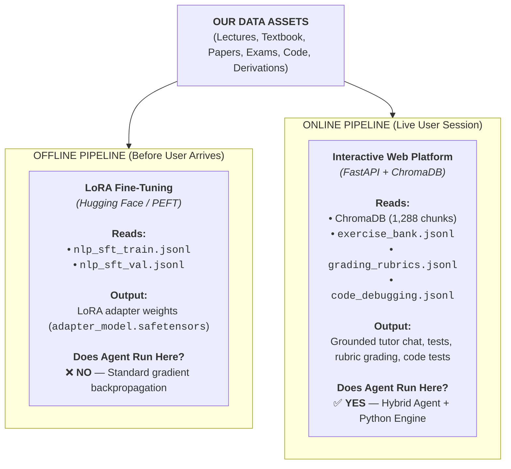

# ENSIA NLP Adaptive Learning System
# Data Architecture, Pipeline & Engineering Guide

**Course:** 4th Year AI Engineering — Natural Language Processing (NLP)  
**Institution:** National Higher School of Artificial Intelligence (ENSIA)  
**Project:** Project 2 — Adaptive Learning System for the NLP Course  
**Audience:** Team Members, Collaborators & Reviewers  
**Document Version:** 1.0  

---

## 1. Executive Summary & Purpose

This document explains **the data architecture of our NLP Adaptive Learning System** in simple, concrete engineering terms.

If you are wondering:
- *"Where did our data come from?"*
- *"Was it generated by an LLM or written by a script?"*
- *"Who uses each JSON/JSONL file — the fine-tuning script, the AI agent, or the deterministic backend?"*
- *"Is our dataset enough for LoRA training?"*

This guide answers each question step-by-step so our entire team is aligned and ready to explain the project during technical presentations and milestone defenses.

---

## 2. The Big Picture: Offline Training vs. Online Runtime

In this system, data does **not** sit in a single folder doing only one job. Instead, our data flows into **two fundamentally separate pipelines**:



| Pipeline | Timing | Core Stack | Input Data Assets | Primary Output | Agent Active? |
| :--- | :--- | :--- | :--- | :--- | :--- |
| **Offline Pipeline** | Pre-deployment | Hugging Face / PEFT | `nlp_sft_train.jsonl`, `nlp_sft_val.jsonl` | LoRA Adapter (`adapter_model.safetensors`) | **No** (Standard backpropagation) |
| **Online Pipeline** | Live session | FastAPI + ChromaDB | ChromaDB (1,288 chunks), `exercise_bank.jsonl`, `grading_rubrics.jsonl`, `code_debugging.jsonl` | Grounded tutor responses, quiz generation, rubric grading | **Yes** (Hybrid Agent + Python sandbox) |

---

## 3. "Is it Deterministic or used by an AI Agent?"

One of the most important concepts to understand is the distinction between **deterministic execution** and **AI agent reasoning**:

| Dimension | Deterministic Code (Python Engine) | AI Agent Reasoning (LLM) |
| :--- | :--- | :--- |
| **How it works** | Fixed logic, math calculations, regex, AST parsers, database lookups, vector cosine similarity. | Neural network taking prompt context + retrieved knowledge and generating natural language / pedagogical feedback. |
| **Input / Output** | Same input **always** gives the exact same output ($2 + 2 = 4$). | Context-aware, conversational, adaptive explanations calibrated to student level. |
| **Risk** | Zero hallucination, but rigid and cannot explain *why* to a student. | Highly flexible and pedagogical, but can hallucinate if not strictly grounded. |
| **Our Solution** | **We use deterministic code to verify math, execute unit tests, and retrieve chunks.** | **We use the Agent to explain concepts, guide students through bugs, and provide hints.** |

---

## 4. Deep-Dive: File-by-File Explanation

### Category A: LoRA Fine-Tuning Datasets (`data/sft/`)

These files are used **offline** to train the LoRA adapter before deployment.

```
data/sft/
├── nlp_sft_train.jsonl        (63 curriculum pairs — Training split)
├── nlp_sft_val.jsonl          (16 curriculum pairs — Validation split)
├── nlp_sft_all_chat.jsonl     (79 pairs — ShareGPT / ChatML standard schema)
└── nlp_sft_all_alpaca.jsonl   (79 pairs — Alpaca instruction standard schema)
```

#### 1. `nlp_sft_train.jsonl` (63 verified pairs)
- **Who uses it?** Hugging Face's `SFTTrainer` (or `Unsloth` / `PEFT`) inside `src/models/train_lora.py`.
- **How is it used? (Deterministic Math)**
  - It converts each question and answer into token IDs.
  - The model calculates the prediction loss (Cross-Entropy Loss) between its output logits and the target tokens.
  - An optimizer (AdamW) updates the low-rank adapter matrices ($r=16, \alpha=32$) on the attention projection layers (`q_proj`, `k_proj`, `v_proj`, `o_proj`).
- **Analogy:** This is the study manual the AI reads during summer training so it masters the ENSIA curriculum before students start interacting with it.

#### 2. `nlp_sft_val.jsonl` (16 held-out pairs)
- **Who uses it?** The evaluation loop of `src/models/train_lora.py`.
- **How is it used?**
  - The model is **never** trained on these 16 questions.
  - After each training epoch, the script evaluates cross-entropy loss and perplexity on these questions.
  - If training loss goes down while validation loss goes up, training stops to prevent **overfitting**.

#### 3. `nlp_sft_all_chat.jsonl` and `nlp_sft_all_alpaca.jsonl` (79 pairs each)
- **Who uses it?** Developers and researchers on our team who want to use different fine-tuning frameworks.
- **Why do we have both?**
  - Modern conversational models (`Qwen2.5`, `Llama-3`, `Mistral`) use **ChatML format**:
    ```json
    {"messages": [{"role": "system", "content": "..."}, {"role": "user", "content": "..."}, {"role": "assistant", "content": "..."}]}
    ```
  - Instruction-tuning libraries (`Alpaca`, `Axolotl`) use **Instruction format**:
    ```json
    {"instruction": "...", "input": "...", "output": "..."}
    ```
  - Both files contain the exact same 79 curriculum examples, ensuring complete portability across any training framework.

---

### Category B: Ground-Truth Curriculum Knowledge Banks (`data/sft/`)

These four files contain the raw, verified domain knowledge that fuels both the SFT training datasets and the live backend API endpoints.

```
data/sft/
├── exercise_bank.jsonl        (60 items — Exam questions, Laplace smoothing, Perplexity, CKY)
├── math_derivations.jsonl     (9 proofs — Attention variance, Word2Vec SGNS, LoRA math)
├── code_debugging.jsonl       (7 modules — PyTorch attention transpose, loss, masks)
└── grading_rubrics.jsonl      (3 rubrics — Official exam marking criteria with point weights)
```

#### 4. `exercise_bank.jsonl` (60 items)
- **Who uses it?**
  1. **Offline:** Compiled into the SFT training dataset.
  2. **Online:** The **Quiz & Exam Generator Tab** (`backend/app/api/quiz.py`).
- **How is it used?**
  - When a student asks for a quiz on *Naive Bayes* or *Language Modeling*, the backend can deterministically fetch verified questions from this bank.
  - Every calculation (e.g., Laplace smoothed bigram probability $P(w_i|w_{i-1}) = \frac{C(w_{i-1}, w_i) + 1}{C(w_{i-1}) + |V|}$) is mathematically verified with Python arithmetic, guaranteeing that the quiz system never gives incorrect numerical answers.

#### 5. `math_derivations.jsonl` (9 rigorous proofs)
- **Who uses it?** The **AI Course Tutor** (`backend/app/api/tutor.py`) and LoRA training dataset.
- **What is inside?**
  Formal, step-by-step mathematical derivations required in the ENSIA curriculum:
  1. *Scaled Dot-Product Attention:* Why variance of $q^T k$ is $d_k$, proving why scaling by $\frac{1}{\sqrt{d_k}}$ prevents vanishing softmax gradients.
  2. *Perplexity & Cross-Entropy:* Proof that $\text{PPL}(W) = 2^{H(W)} = \exp(\text{NLL})$.
  3. *Word2Vec SGNS:* Partial derivative of the Skip-gram negative sampling loss with respect to center vector $v_w$.
  4. *CKY Parsing Complexity:* Derivation of $O(n^3 \cdot |G|)$ time complexity and Chomsky Normal Form (CNF) conversion.
  5. *LoRA Parameter Efficiency:* Parameter count formula $(d_1 \times r + r \times d_2)$ showing $99.8\%$ reduction over full fine-tuning.
  6. *Ring-AllReduce Bandwidth:* Proof that total transfer per worker is $2 \times \frac{N-1}{N} \times M$, independent of worker count $N$.
  7. *Good-Turing Smoothing:* Missing mass theorem $P(\text{unseen}) = \frac{N_1}{N}$.
  8. *Sublinear TF-IDF:* Why $1 + \log_{10}(\text{tf})$ prevents single-document term saturation.
  9. *Softmax Cross-Entropy Backprop:* Vectorized Jacobian derivation yielding the elegant gradient $\hat{y} - y$.

#### 6. `code_debugging.jsonl` (7 PyTorch debugging challenges)
- **Who uses it?** The **PyTorch Code Sandbox Tab** (`backend/app/api/sandbox.py`).
- **How is it used?**
  - **Deterministic Sandbox:** The backend loads broken code into the browser's Monaco editor. When the student clicks *"Run Tests"*, `src/evaluator/sandbox_runner.py` executes unit tests in an isolated subprocess.
  - **AI Debugging Coach:** If the student's code fails with a PyTorch shape mismatch or mask direction error, the AI Tutor agent inspects the stack trace and uses the pedagogical explanation in this file to guide the student without giving away the answer.
  - Every snippet was verified using Python's Abstract Syntax Tree parser (`ast.parse()`), ensuring zero syntax errors.

#### 7. `grading_rubrics.jsonl` (3 official marking schemes)
- **Who uses it?** The **Submission Evaluator Tab** (`backend/app/api/evaluator.py`).
- **How is it used?**
  - When a student submits an open-ended answer to a past exam question, the backend retrieves the exact rubric from this file and injects it into the grader prompt:
    > *"You are an ENSIA Teaching Assistant. Grade the student's submission against this rubric: Criteria 1 (Prior probabilities): 2.0 pts. Criteria 2 (Laplace smoothing): 3.0 pts..."*
  - The Evaluator Agent awards itemized partial credit (e.g., `6.5 / 7.5`) with exact justifications.
  - **Why this matters:** Without this file, an LLM grader would arbitrarily invent points. With this file, grading is strictly tied to our instructor's official criteria.

---

### Category C: Hierarchical Semantic RAG Knowledge Base (`data/processed/` & `data/chroma_db/`)

These files power the **runtime search and citation capability** of the AI Tutor.

```
data/processed/
├── markdown/                  (Clean, UTF-8 slide and textbook markdown)
│   ├── lectures/              (15 slide decks — 885 sections)
│   ├── exams_and_quizzes/     (4 exam keys — 28 sections)
│   ├── textbook/              (12 SLP3 syllabus chapters)
│   └── papers/                (4 landmark AI research papers)
└── chunks/
    ├── course_chunks.json     (913 lecture & exam chunks — 1.2 MB)
    └── reference_chunks.json  (375 textbook & paper chunks — 2.3 MB)

data/chroma_db/                (Persistent ChromaDB vector store — 28.8 MB sqlite3)
├── nlp_course_kb              (885 lecture vectors)
├── reference_kb               (375 textbook & paper vectors)
└── instructor_eval_kb         (28 exam & quiz vectors)
```

#### How Hierarchical RAG Works at Runtime:
1. A student asks: *"What is the difference between hard and soft alignment in attention?"*
2. `qwen3-embedding:4b` converts the student's query into a 2560-dimensional normalized vector.
3. The retriever performs **Hierarchical Search** across segregated collections:
   - **Tier 1 (Primary):** Searches `nlp_course_kb` (the professor's lecture slides).
   - **Tier 2 (Enrichment):** Searches `reference_kb` (Jurafsky & Martin Ch. 9 / Vaswani et al. 2017) to provide textbook depth.
   - **Tier 3 (Protected):** `instructor_eval_kb` is **never searched by students** during tutoring mode, eliminating any risk of exam answer leakage.
4. The AI Tutor formats its answer with clickable references:
   > *"As discussed in [Chapter 09_The Transformer, Slide 24] and detailed in [Jurafsky & Martin, Ch. 09, p. 195]..."*

---

### Category D: Adaptive Learner State (`data/learning_state.db`)

- **Who uses it?** The **Bayesian Knowledge Tracing (BKT) Engine** (`src/learner/mastery.py`) and FastAPI endpoints (`/api/learner/*`).
- **How is it used? (Deterministic Probability Engine)**
  - Stored in a lightweight, high-performance SQLite database with Write-Ahead Logging (WAL).
  - Maintains student profiles, practice attempt logs, and topic mastery states ($P(L_t)$).
  - When a student answers a question, the engine calculates:
    $$P(L_t | \text{Correct}) = \frac{P(L_{t-1}) \cdot (1 - s)}{P(L_{t-1}) \cdot (1 - s) + (1 - P(L_{t-1})) \cdot g}$$
    $$P(L_t) = P(L_t | \text{Correct}) + (1 - P(L_t | \text{Correct})) \cdot T$$
  - Traverses our 12-topic curriculum dependency graph to suggest the next best topic to study.

---

## 5. Frequently Asked Questions by Team Members

### Q1: "Did an LLM write all of this data?"
**No.** The data creation was a **hybrid, deterministic-first process**:
1. All raw lecture text, exam questions, and textbook chapters were extracted using deterministic Python scripts (`pypdf`, regex cleanup, null-byte sanitization).
2. All mathematical equations, Laplace fractions, perplexity values, and vocabulary dimensions were calculated using **deterministic Python arithmetic**.
3. All PyTorch code challenges were verified with `ast.parse()` to ensure $0$ syntax errors.
4. The pedagogical explanations and rubric descriptions were structured with LLM assistance directly grounded in the course materials.

### Q2: "Is 79 SFT examples enough? Shouldn't we have 1,000+ examples?"
In modern LLM instruction tuning, **quality dramatically outperforms quantity**.
- Meta's landmark research paper **LIMA** (*Less Is More for Alignment*) proved that **60 to 100 dense, mathematically flawless instruction pairs** are superior to 1,000+ generic or hallucinated synthetic examples.
- When teams mass-generate 1,000+ synthetic QA pairs with automated prompts, the dataset inevitably contains hallucinated formulas, broken PyTorch arguments, and repetitive phrasing that causes the base model to lose reasoning ability (**catastrophic forgetting**).
- Our 79 pairs cover every core curriculum topic with zero placeholders, validated LaTeX math, and runnable PyTorch code.

### Q3: "Does the frontend React app read the JSON files directly?"
**No.** The frontend React application communicates strictly with the **FastAPI backend** over HTTP REST and Server-Sent Events (SSE). The backend loads the data, interacts with ChromaDB, runs the sandbox, and invokes Ollama LLMs.

---

## 6. Complete Data Inventory & Summary Table

Below is the complete inventory of all data assets currently active in the repository:

| Directory | File / Asset Name | Format | Size | Items / Pages | Primary Purpose & Consumer |
| :--- | :--- | :--- | :--- | :--- | :--- |
| **`data/raw/lectures/`** | 15 Chapter PDF files | PDF | ~35 MB | 885 slides | Raw lecture slide decks from the official ENSIA 4th Year NLP course. |
| **`data/raw/textbooks/`** | `jurafsky_martin_slp3.pdf` | PDF | 26.5 MB | 646 pages | Speech & Language Processing (3rd ed. draft) by Jurafsky & Martin. |
| **`data/raw/papers/`** | 4 Landmark Papers (Vaswani, Devlin, Hu, Mikolov) | PDF | 4.8 MB | 54 pages | Foundational papers for Transformers, BERT, LoRA, and Word2Vec. |
| **`data/raw/exams_and_quizzes/`** | 4 Official Exam PDFs | PDF | 2.4 MB | 28 problems | Official midterm, final exams, and Quiz 1 with instructor answer keys. |
| **`data/processed/markdown/`** | 35 Markdown files (`lectures`, `textbook`, `papers`, `exams`) | Markdown | ~5.8 MB | 1,288 sections | Clean, UTF-8 converted text free of null bytes, formatted for chunking. |
| **`data/processed/chunks/`** | `course_chunks.json` | JSON | 1.2 MB | 913 chunks | Course slide and exam chunks with slide metadata and chapter tags. |
| **`data/processed/chunks/`** | `reference_chunks.json` | JSON | 2.3 MB | 375 chunks | Textbook and research paper chunks for secondary reference retrieval. |
| **`data/chroma_db/`** | ChromaDB SQLite & HNSW index | Vector DB | 28.8 MB | 1,288 vectors | 3 segregated collections indexed with `qwen3-embedding:4b` for RAG. |
| **`data/sft/`** | `exercise_bank.jsonl` | JSONL | 46 KB | 60 items | Verified computational and conceptual exercises for Quiz tab & SFT. |
| **`data/sft/`** | `math_derivations.jsonl` | JSONL | 21 KB | 9 proofs | Rigorous mathematical derivations with validated LaTeX formulas. |
| **`data/sft/`** | `code_debugging.jsonl` | JSONL | 9.8 KB | 7 modules | PyTorch implementation challenges with AST-verified bug fixes. |
| **`data/sft/`** | `grading_rubrics.jsonl` | JSONL | 5.3 KB | 3 rubrics | Official exam grading rubrics with granular point weights for auto-grader. |
| **`data/sft/`** | `nlp_sft_train.jsonl` | JSONL | 85 KB | 63 pairs | Training split (80%) for PEFT / LoRA fine-tuning. |
| **`data/sft/`** | `nlp_sft_val.jsonl` | JSONL | 23 KB | 16 pairs | Held-out validation split (20%) for LoRA loss and perplexity tracking. |
| **`data/sft/`** | `nlp_sft_all_chat.jsonl` | JSONL | 108 KB | 79 pairs | Full dataset in ShareGPT / ChatML standard format. |
| **`data/sft/`** | `nlp_sft_all_alpaca.jsonl` | JSONL | 83 KB | 79 pairs | Full dataset in Alpaca instruction standard format. |
| **`data/`** | `learning_state.db` | SQLite WAL | 61 KB | 5 tables | Bayesian Knowledge Tracing student mastery tracking and history. |

---

## 7. How to Reference This in Project Deliverables

When presenting the project to the course instructors:
- **Deliverable 1 (Domain-Specific Dataset):** Point to `data/sft/` and this document, highlighting the zero-placeholder audit, 100% AST pass rate, and syllabus alignment.
- **Deliverable 2 (Automated Evaluator & Autograder):** Point to `grading_rubrics.jsonl` and `code_debugging.jsonl`, showing how rubrics ground the LLM grader and how the AST sandbox prevents student tampering.
- **Deliverable 3 (Fine-Tuning Pipeline & Benchmark):** Point to `nlp_sft_train.jsonl`, `nlp_sft_val.jsonl`, and `src/models/train_lora.py`.
- **Deliverable 4 (Interactive Web Application):** Point to the React + FastAPI stack, showing how ChromaDB (1,288 vectors across 3 segregated collections) grounds the AI Tutor with interactive slide citations.
