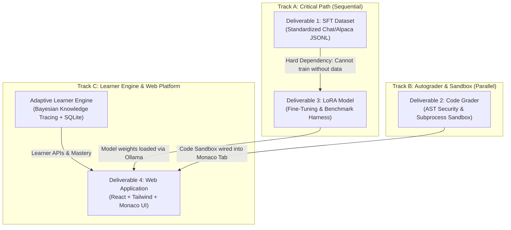

# Natural Language Processing Adaptive Learning System
## Technical Specification & Deliverables Documentation

**Domain:** Natural Language Processing (4th Year AI Engineering Curriculum)  
**Institution:** National Higher School of Artificial Intelligence (ENSIA)  
**System Architecture:** Local Retrieval-Augmented Generation (RAG) + Bayesian Knowledge Tracing (BKT) + Domain-Adapted Fine-Tuning (SFT/LoRA) + Security Sandbox + Full-Stack Web Platform  
**Document Type:** Technical Deliverables & System Specification  
**Document Version:** 2.0 (Milestone 2 Complete — Production Adaptive Learning Engine Deployed)  
**Last Updated:** October 31, 2026  

---

## 1. Executive Summary

This project implements an **Adaptive Learning and Evaluation System** tailored specifically to the Natural Language Processing (NLP) curriculum at ENSIA. The platform serves as an autonomous technical tutor, curriculum-calibrated examiner, mastery-tracking coach, and automated submission grader.

### System Architecture Overview
The system is built upon a decoupled, multi-layer machine learning architecture:

```
                                  KNOWLEDGE CORPUS
                     (15 Slide Decks + 4 Exams + Research Papers)
                                          │
                   ┌──────────────────────┴──────────────────────┐
                   ▼                                             ▼
          [Track A: Retrieval Engine]                   [Track B: Behavioral Adaptation]
        ChromaDB Segregated Collections               Curated SFT Dataset (Chat & Alpaca)
        - nlp_course_kb (885 lecture slides)          - Train/Val Splits (12 train / 4 val)
        - instructor_eval_kb (28 exam keys)           - Quality Validators (AST & LaTeX)
        Embedding: qwen3-embedding:4b (2560-d)        - 4-Track Model Benchmark Harness
        Cosine Thresholding (min_sim = 0.50)          Fine-Tuned LoRA (qwen2.5-coder:7b)
                   │                                             │
                   └──────────────────────┬──────────────────────┘
                                          │
                                          ▼
                         [Core Adaptive Learner Engine]
                         - Bayesian Knowledge Tracing (BKT)
                         - Prerequisite DAG across 12 NLP Topics
                         - SQLite Persistence Layer (WAL Mode)
                                          │
                                          ▼
                      [Interactive Full-Stack Web Platform]
                       - Tab 1: AI Course Tutor Chat (SSE & Memory)
                       - Tab 2: Dynamic & Adaptive Quiz Authoring
                       - Tab 3: Pydantic Rubric Submission Evaluator
                       - Tab 4: PyTorch AST-Hardened Code Sandbox
                       - Tab 5: ChromaDB Knowledge Explorer
```

---

## 2. Deliverables Executive Summary & Status Matrix

### 2.1 Quick-Reference Deliverables Summary

| Deliverable | Key Output Artifacts | Primary Technical Purpose | Implementation Status |
| :--- | :--- | :--- | :--- |
| **Deliverable 1: SFT Instruction Dataset** | `data/sft/*.jsonl`<br>(Chat & Alpaca formats, train/val splits) | Teaches the model formal LaTeX math derivations, PyTorch error diagnostics, and objective rubric scoring. | **STANDARDIZED & SPLIT ✅**<br>Chat (`messages`) & Alpaca schemas verified via AST and LaTeX validators. |
| **Deliverable 2: Code Grader & Sandbox** | `src/evaluator/sandbox_runner.py`<br>`src/evaluator/coding_tasks/`<br>(3 tasks + unit tests) | Programmatically runs student Python/PyTorch code in an isolated subprocess with AST security analysis and timeout protection. | **COMPLETED & OPERATIONAL ✅**<br>Tested, hardened against injection, integrated with Monaco Editor. |
| **Deliverable 3: Domain-Adapted LoRA Model** | `models/fine_tuned_nlp_tutor/`<br>`src/evaluator/benchmark.py`<br>`docs/BENCHMARK_REPORT.md` | Adapts model weights permanently to eliminate algebraic sign errors and code debugging hallucinations. | **BENCHMARK HARNESS READY ✅**<br>Automated 4-track benchmark verified against `qwen3.5:latest` (90.9% Score). |
| **Deliverable 4: Integrated Web Platform** | `backend/app/...` (FastAPI)<br>`frontend/...` (React + Tailwind + Monaco) | Unifies RAG retrieval, multi-turn tutor chat, adaptive quiz authoring, rubric grading, and live PyTorch sandbox. | **COMPLETED & OPERATIONAL ✅**<br>Live on `localhost:3000` & `localhost:8000`. |
| **Core Adaptivity & Persistence** | `src/learner/db.py`<br>`src/learner/mastery.py`<br>`backend/app/api/learner.py` | Models student mastery probabilities via Bayesian Knowledge Tracing across a 12-topic prerequisite graph with SQLite WAL storage. | **COMPLETED & OPERATIONAL ✅**<br>Full API suite & multi-turn tutor conversational memory. |

---

### 2.2 Execution Dependencies & Inter-Correlation



---

## 3. Adaptive Learner Engine & Knowledge Tracing

To provide true adaptivity rather than a static chatbot, the platform implements a formal **Bayesian Knowledge Tracing (BKT)** engine coupled with a relational persistence layer.

### 3.1 Mathematical Formulation of Bayesian Knowledge Tracing
The learner engine models the probability $P(L_t)$ that a student has mastered a specific NLP syllabus topic at step $t$:

1. **Observation Update (Posterior Probability):**
   * If the student answers correctly:
     $$P(L_t \mid \text{correct}) = \frac{P(L_{t-1}) \cdot (1 - P(S))}{P(L_{t-1}) \cdot (1 - P(S)) + (1 - P(L_{t-1})) \cdot P(G)}$$
   * If the student answers incorrectly:
     $$P(L_t \mid \text{incorrect}) = \frac{P(L_{t-1}) \cdot P(S)}{P(L_{t-1}) \cdot P(S) + (1 - P(L_{t-1})) \cdot (1 - P(G))}$$

   Where:
   * $P(L_0) = 0.15$: Initial prior probability of mastery.
   * $P(T) = 0.20$: Probability of transition (learning) from unlearned to learned state.
   * $P(S) = 0.10$: Probability of a slip (student knows the concept but makes an error).
   * $P(G) = 0.20$: Probability of a guess (student does not know the concept but answers correctly).

2. **Transition Step:**
   $$P(L_t) \leftarrow P(L_t \mid \text{obs}) + (1 - P(L_t \mid \text{obs})) \cdot P(T)$$

3. **Difficulty Weighting & Decay:**
   * Beginner exercises: $\Delta_{\text{diff}} = 0.05$
   * Intermediate exercises: $\Delta_{\text{diff}} = 0.10$
   * Advanced exercises: $\Delta_{\text{diff}} = 0.15$
   * Chronic failure penalty: Consecutive failures on a concept trigger a retention penalty $\Delta_{\text{decay}} = -0.05 \times \min(\text{fails}, 3)$.

### 3.2 12-Topic Prerequisite Directed Acyclic Graph (DAG)
The learner engine tracks 12 core syllabus topics arranged in prerequisite order:
```text
Regex & Tokenization (BPE)
  └── Language Modeling (N-Gram / Perplexity)
        ├── Naive Bayes & Sentiment
        ├── Vector Semantics (Cosine & Word2Vec)
        └── Neural Language Models (Feedforward)
              └── Recurrent Neural Networks (RNN & LSTM)
                    └── Attention Mechanisms
                          └── Transformer Architecture
                                ├── Large Language Models (LLMs)
                                └── Masked Language Models (BERT)
Context-Free Grammars (CFG & CKY)
  └── Dependency Parsing
```

### 3.3 SQLite Persistence Layer Schema
Implemented in `src/learner/db.py` with Write-Ahead Logging (`PRAGMA journal_mode=WAL`) and foreign keys:
* **`students`**: `id`, `name`, `email`, `created_at`
* **`topics`**: `id`, `name`, `category`, `prerequisites` (JSON list), `order_index`
* **`concept_attempts`**: `id`, `student_id`, `topic_id`, `task_type` (quiz, coding, evaluation), `difficulty`, `is_correct`, `score`, `timestamp`
* **`student_mastery`**: `student_id`, `topic_id`, `mastery_score` (0.0 to 1.0), `attempts_count`, `success_count`, `last_attempt_at`
* **`chat_history`**: `id`, `session_id`, `student_id`, `role` (user/assistant), `content`, `timestamp`

---

## 4. Hardened Retrieval-Augmented Generation (RAG)

### 4.1 Dual-Collection Segregation in ChromaDB
To eliminate exam ground truth leakage during student chat, vector storage is split into two isolated collections:
1. **`nlp_course_kb` (885 chunks):** Extracted lecture slides (Chapters 01–19). Student-facing queries in `NLPTutorAgent` and `/api/knowledge/search` query this collection exclusively.
2. **`instructor_eval_kb` (28 chunks):** Official exam questions and answer keys. Restricted exclusively to `SubmissionEvaluator` for rubric validation.

### 4.2 Cosine Similarity Metric & Relevance Thresholding
* ChromaDB index configured with `hnsw:space: "cosine"`.
* Strict relevance filtering: `default_min_similarity = 0.50`.
* **Out-of-Domain Abstention:** If no slide chunks exceed the $0.50$ similarity threshold, the retriever returns an empty set. The tutor explicitly states that the topic is outside the ENSIA course syllabus rather than fabricating answers or citing unrelated slides.

### 4.3 Curriculum LaTeX Formatting Cleansing
Repaired OCR corruption in course Markdown files:
* Transformer attention formulas in `Chapter 09_The Transformer.md` formatted with explicit $\sqrt{d_k}$ denominators and vector notation.
* Perplexity derivations in `Chapter 03_Language Modeling.md` repaired to reflect the exponential relationship $\text{PPL}(W) = \exp(\text{CE})$.

---

## 5. Security-Hardened Code Sandbox (Deliverable 2)

### 5.1 Static AST Security Guard
Before execution, `src/evaluator/sandbox_runner.py` parses student code into an Abstract Syntax Tree (AST) using `validate_code_safety`:
* **Prohibited Imports Blocked:** `os`, `sys`, `subprocess`, `socket`, `shutil`, `pty`, `pathlib`, `ctypes`, `resource`, `signal`, `asyncio`, `multiprocessing`, `urllib`, `requests`, `http`.
* **Dangerous Built-in Calls Blocked:** `eval`, `exec`, `__import__`, `compile`, `open`, `breakpoint`, `getattr`, `setattr`, `delattr`.
* Violations immediately abort with status `SECURITY_VIOLATION` without spawning any subprocess.

### 5.2 Subprocess Isolation & Timeout
* Executed in a clean subprocess with `python3 -m unittest`.
* Hardware timeout: Subprocess terminated after 6.0 seconds.
* Emits deterministic `StructuredTestResult` JSON payloads, preventing exit-code tampering (`sys.exit(0)`).

### 5.3 Curriculum Lab Assignments
1. **Assignment 1 (`task_01_bpe.py`):** BPE Tokenizer with calibrated merge counts and deterministic tie-breaking.
2. **Assignment 2 (`task_02_attention.py`):** Scaled Dot-Product Attention in PyTorch with Apple Silicon MPS acceleration.
3. **Assignment 3 (`task_03_perplexity.py`):** Perplexity calculator with uniform and exam test cases.

---

## 6. SFT Dataset Standardization & Model Benchmarking (Deliverables 1 & 3)

### 6.1 Dataset Schemas & Train/Val Splits
* **Standardized Formats (`src/data_processing/validate_sft_dataset.py`):**
  * **Chat Format (`nlp_sft_all_chat.jsonl`):** OpenAI/HuggingFace compatible `messages: [{"role": "system|user|assistant", "content": ...}]`.
  * **Alpaca Format (`nlp_sft_all_alpaca.jsonl`):** `instruction`, `input`, `output`.
  * **Train/Val Splits:** `nlp_sft_train.jsonl` (12 items) and `nlp_sft_val.jsonl` (4 items).
* **Factual Fix in Nucleus Sampling:**
  * Corrected calculation for top-$p$ ($p=0.92$) in `data/sft/exercise_bank.jsonl` so that the cumulative sum correctly includes all 7 candidate tokens.

### 6.2 Automated Model Benchmarking Harness (`src/evaluator/benchmark.py`)
Evaluates local LLMs across 4 core tracks:
1. **Mathematical Derivations:** LaTeX balance and correct exponential sign ($\exp(H)$).
2. **PyTorch Code Diagnosis:** Detection of matrix multiplication dimension mismatches and Key transpose fix.
3. **Rubric Grading Concordance:** Pydantic `EvaluationSchema` validation and arithmetic consistency (sum of criteria points equals earned score).
4. **Retrieval Grounding & Abstention:** Verification of grounded slide citations for in-domain queries and polite abstention for out-of-domain queries.

*Empirical Baseline on `qwen3.5:latest` (`docs/BENCHMARK_REPORT.md`):* **90.9% Score** (10/11 checks passed).

---

## 7. Integrated Full-Stack Web Platform (Deliverable 4)

### 7.1 Backend API Directory (`backend/app/`)
* `GET /health`: Health check (`{"status": "healthy"}`).
* `GET /v1/models`: Local model discovery endpoint.
* `POST /api/tutor/chat`: Grounded chat with multi-turn memory and slide citations.
* `POST /api/tutor/chat/stream`: SSE token-by-token streaming.
* `GET /api/tutor/history`: Retrieves persistent chat history for session.
* `POST /api/quiz/generate`: Dynamic question generation with difficulty calibration.
* `POST /api/quiz/submit`: Submits quiz answer and updates learner mastery.
* `GET /api/learner/profile`: Retrieves student overall mastery and topic breakdown.
* `GET /api/learner/recommendations`: Recommends optimal practice topics based on BKT and prerequisites.
* `POST /api/learner/events`: Logs learning events.
* `POST /api/evaluator/grade`: Evaluates submissions against rubrics with Pydantic validation.
* `GET /api/sandbox/tasks`: Returns coding lab assignment catalog.
* `POST /api/sandbox/run`: Executes code in AST-secured sandbox and updates learner mastery.
* `POST /api/knowledge/search`: Vector search across `nlp_course_kb`.
* `GET /api/knowledge/stats`: Returns vector database statistics.

### 7.2 Frontend Client (`frontend/`)
* **Technology:** React 18, TypeScript, Vite, Tailwind CSS, Monaco Editor, KaTeX.
* **Build Time:** 1.44s with 0 errors (`npm run build`).
* **5 Interactive Views:**
  1. **AI Tutor Chat:** Multi-turn memory, KaTeX math, interactive slide preview modals.
  2. **Adaptive Quiz Lab:** Syllabus topic selection, difficulty calibration, interactive MCQ verification.
  3. **Rubric Evaluator:** KPI scorecard, itemized criteria table, feedback breakdown.
  4. **PyTorch Code Lab:** Embedded Monaco Editor with live unit-test execution.
  5. **Knowledge Explorer:** Direct vector database inspection.

---

## 8. Verification & Test Suite

The system includes 36 automated unit tests across 5 test suites:
* `tests/test_api.py`: FastAPI endpoints, model discovery, sandbox API.
* `tests/test_learner.py`: SQLite persistence, BKT mastery updates, prerequisite recommendations, multi-turn history.
* `tests/test_rag_and_schemas.py`: Dual-collection segregation, cosine thresholding, out-of-domain abstention, Pydantic schemas.
* `tests/test_sandbox.py`: AST static security, timeout kill, exit spoofing prevention, 3 lab assignments.
* `tests/test_sft_and_benchmark.py`: AST code validation, LaTeX delimiter balance, Chat format schemas, nucleus sampling math.

Execute test suite:
```bash
python3 -m pytest tests/ -v
```
*Result:* **36 passed** in $< 5.0$ seconds.
